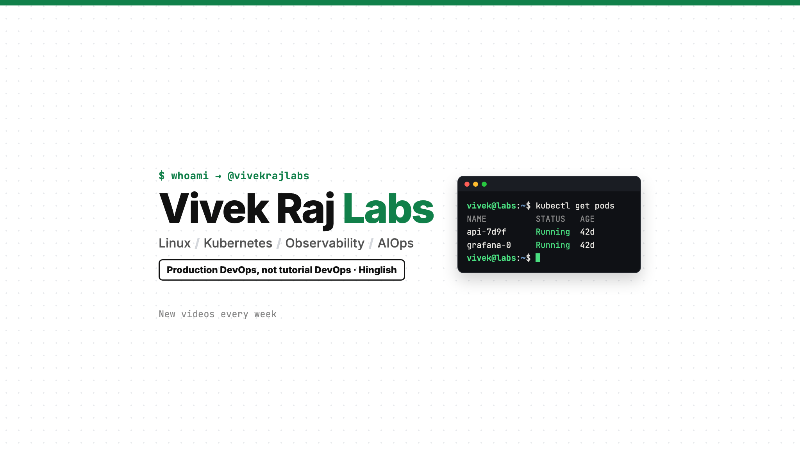

  

<h1 align="center">Linux for DevOps: Hands-on Labs</h1>

  
  
  
  

Practice labs for the **Linux for DevOps** series on YouTube, from absolute zero to job-ready.
Watch an episode, then come here and **do it yourself**: tasks, a challenge, interview questions, solutions
and a one-page cheat sheet for every episode.

> Watching teaches you what a command is. Typing it teaches you Linux.

📺 **Videos:** [youtube.com/@vivekrajlabs](https://www.youtube.com/@vivekrajlabs) (every episode in English and Hindi)

## Start here

1. **Get a free Linux machine** (5 minutes): see [setup.md](setup.md) for Windows (WSL), Mac (Multipass) or a cloud VM.
2. **Pick an episode** below, watch the video, then open its folder.
3. Do the **tasks** in order, try the **challenge**, answer the **interview questions**, and only then check `solutions.md`.
4. Keep the `cheatsheet.md` open while you work.

## Episodes

| # | Episode | Lab |
|---|---------|-----|
| 1 | What is Linux, and why DevOps needs it | [ep01-what-is-linux](ep01-what-is-linux/) ✅ |
| 2 | Moving around: `pwd`, `ls`, `cd` | coming soon |
| 3 | Working with files | coming soon |
| 4 | Finding things: `find`, `grep`, pipes | coming soon |
| 5 | Users, groups and `sudo` | coming soon |
| 6 | Permissions and ownership | coming soon |
| 7 | Advanced permissions | coming soon |
| 8 | Environment variables and `PATH` | coming soon |
| 9 | Processes | coming soon |
| 10 | Memory, load and limits | coming soon |
| 11 | Installing software | coming soon |
| 12 | Services and boot (systemd) | coming soon |
| 13 | Links and archives | coming soon |
| 14 | Disk and storage | coming soon |
| 15 | Logs and text power tools | coming soon |
| 16 | Networking commands | coming soon |
| 17 | SSH and file copy | coming soon |
| 18 | Cron and automation | coming soon |
| 19 | Troubleshooting lab (finale) | coming soon |

A new lab lands with every new video. ⭐ Star the repo to get notified.

## Rules that make you learn faster

- **Type, don't paste.** Your fingers need to learn the commands.
- **Break things on purpose.** Mistype a command and read the error. Errors are the best teachers.
- **Stuck?** Run `man <command>` or `<command> --help` first, then ask in the YouTube comments.
- **Never** paste a command from the internet that you don't understand, especially one with `sudo` or `rm`.

## Contributing

Found a typo or a command that behaves differently on your machine? Open an issue with your distro, version and the exact
output. Pull requests for clearer explanations are welcome.

## License

[MIT](LICENSE): use these labs to learn, teach, or run a study group.
